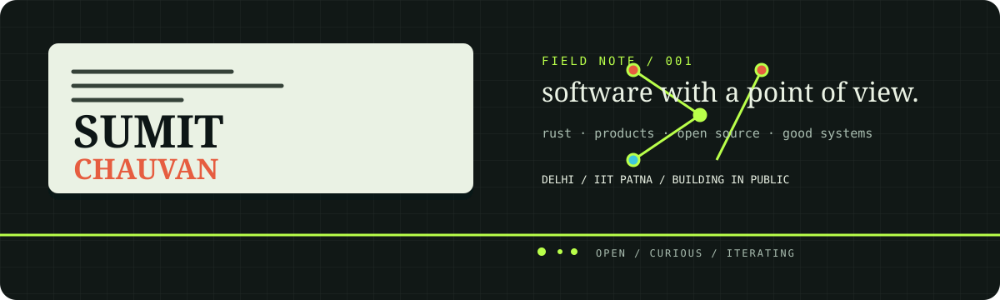
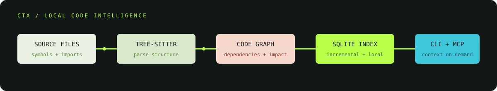
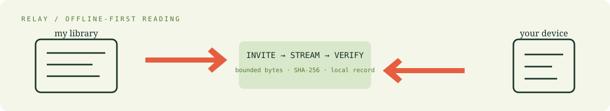
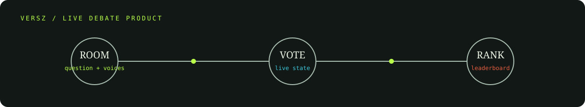
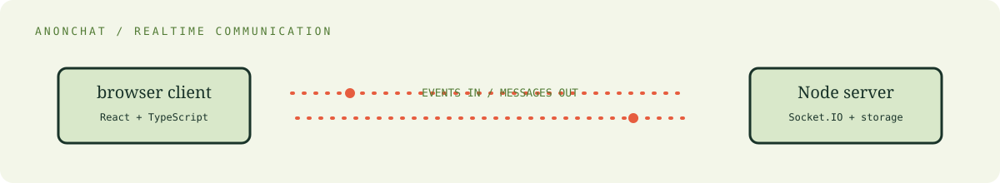
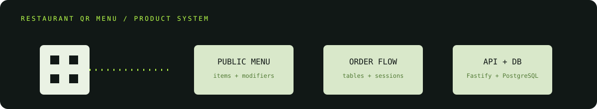
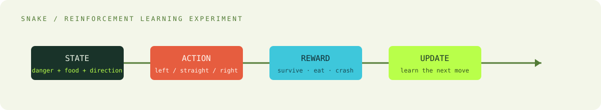

  <picture>
    <source media="(max-width: 600px) and (prefers-color-scheme: dark)" srcset="assets/studio/hero-dark-mobile.svg" />
    <source media="(max-width: 600px) and (prefers-color-scheme: light)" srcset="assets/studio/hero-light-mobile.svg" />
    <source media="(prefers-color-scheme: dark)" srcset="assets/studio/hero-dark.svg" />
    <source media="(prefers-color-scheme: light)" srcset="assets/studio/hero-light.svg" />
    
  </picture>

  <a href="https://sumitchauhan.me">portfolio</a>
  &nbsp;·&nbsp;
  <a href="https://github.com/halloffame12">github</a>
  &nbsp;·&nbsp;
  <a href="https://www.linkedin.com/in/sumit-chauhan-a4ba98325/">linkedin</a>
  &nbsp;·&nbsp;
  <a href="mailto:sumitchauhan10062004@gmail.com">email</a>

## a small engineering studio

I’m **Sumit Chauhan**, a software developer and computer science student in Delhi, India. I’m pursuing a **BS-MS in Computer Science and Data Analytics at IIT Patna**.

I build the sort of software that makes me want to open the source twice: local developer tools, real-time products, cross-platform apps, and experiments that reveal how a system behaves underneath. Open source is part of that loop — build something useful, publish it, then make the next change less scary.

Right now my attention keeps circling around **Rust, code intelligence, MCP servers, Flutter, backend systems, databases, distributed systems, and reinforcement learning**.

  

## the workbench

| area | things I actually use |
| --- | --- |
| languages | `Rust` · `TypeScript` · `Python` · `Dart` · `SQL` |
| products | `Flutter` · `React` · `Node.js` · `Fastify` |
| systems | `tree-sitter` · `MCP` · `Socket.IO` · `Docker` · `Linux` |
| data | `SQLite` · `PostgreSQL` · `Firebase` · `Drift` |

This is a map of my current work, not a claim that I have mastered every item on it.

## projects with fingerprints

### [CTX](https://github.com/halloffame12/CTX) · code intelligence that stays local

  

My main open-source build: a **Rust codebase intelligence and context engine** for AI coding agents. CTX scans source without executing project code, parses TypeScript, JavaScript, Python, Rust, and Go with tree-sitter, keeps an incremental graph in SQLite, and exposes CLI and MCP workflows for context, search, dependency, impact, symbol, and change analysis.

<a href="https://ctx.sumitchauhan.me/playground/">playground</a>
&nbsp;·&nbsp;
<a href="https://halloffame12.github.io/CTX">docs</a>
&nbsp;·&nbsp;
<a href="https://github.com/halloffame12/CTX/commits/main">source history</a>

### Relay · a quiet library for the offline edge

  

An offline-first Flutter reading app for **PDF and EPUB libraries**. It keeps managed documents on-device, restores reading position and bookmarks, and can transfer a document directly between nearby devices using an explicit invitation, bounded streaming, byte-count and SHA-256 verification, and persisted transfer records. The repository is currently private.

### [VERSZ](https://github.com/halloffame12/versz-app) · product work with a live pulse

  

I’m the **Founder & CTO** of VERSZ, a cross-platform social debate product. The repository is a Flutter application with Firebase functions, Appwrite services, notifications, rooms, debates, voting, comments, search, and leaderboard-oriented product logic.

<a href="https://versz.app">visit versz.app</a>
&nbsp;·&nbsp;
<a href="https://github.com/halloffame12/versz-app">read the repo</a>

### [AnonChat](https://github.com/halloffame12/AnonChat) · communication without the profile parade

  

An anonymous communication project built around a React and TypeScript client, a Node server, Socket.IO services, and a small storage layer. It is an experiment in making the real-time path feel direct while keeping the interface warm rather than clinical.

### Restaurant QR Menu · the unglamorous details matter

  

A production-shaped restaurant menu and ordering platform. The codebase separates a React web app and Fastify API, models menus, modifiers, tables, orders, sessions, and restaurant membership in PostgreSQL, and includes integration coverage for the flows that tend to break at the edges. The repository is currently private.

### [SnakeGame-ai](https://github.com/halloffame12/SnakeGame-ai) · learning by making the loop visible

  

A small reinforcement-learning experiment around Snake. I keep it here because toy environments are honest: state, action, reward, and the consequences of a bad decision are all visible.

## notes from the open-source trail

Two concrete contributions I’m happy to point at:

- [CTX added to `awesome-mcp-servers`](https://github.com/punkpeye/awesome-mcp-servers/commit/6130bd07968915386fc83531451f0235c05723d4)
- [CTX packaged for `winget-pkgs`](https://github.com/microsoft/winget-pkgs/commit/96bb03105df550c0644083262dd317b12704951b)

No trophy cabinet here — just useful places where a project becomes easier for someone else to find and install.

## what is on the bench

| thread | direction |
| --- | --- |
| CTX | sharper code navigation, more language coverage, and a calmer release path |
| Relay | making local reading and device-to-device transfer feel dependable |
| systems curiosity | MCP, databases, realtime state, and the machinery between a good idea and a working product |

## the activity wall

  <picture>
    <source media="(prefers-color-scheme: dark)" srcset="assets/contributions-dark.v2.svg" />
    <source media="(prefers-color-scheme: light)" srcset="assets/contributions-light.v2.svg" />
    
  </picture>

The graph is generated from GitHub activity by the repository workflow; there are no hand-written totals here.

## say hello

If you’re working on developer tools, backend systems, real-time products, or thoughtful open source, I’d enjoy comparing notes.

  <a href="https://sumitchauhan.me"><strong>sumitchauhan.me</strong></a>
  &nbsp;·&nbsp;
  <a href="https://www.linkedin.com/in/sumit-chauhan-a4ba98325/">linkedin</a>
  &nbsp;·&nbsp;
  <a href="mailto:sumitchauhan10062004@gmail.com">sumitchauhan10062004@gmail.com</a>

  

